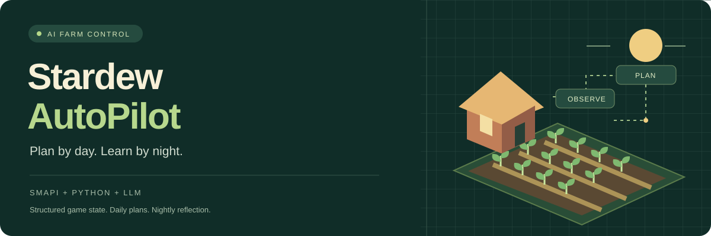
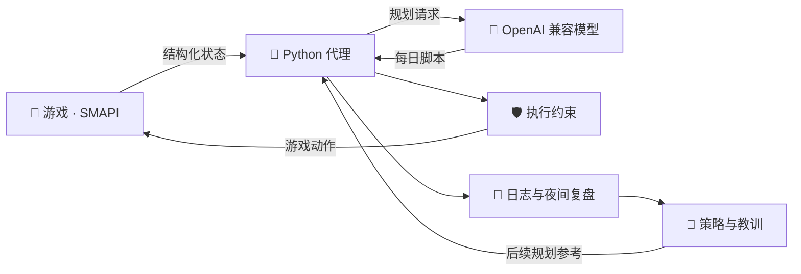

<div align="center">



# Stardew AutoPilot

**让 AI 打理农场，把每一天的经历变成下一天的计划。**

基于真实游戏状态的《星露谷物语》AI 自动驾驶系统

[](CHANGELOG.md)
[](https://smapi.io/)
[](agent/)
[](LICENSE)

[快速开始](#快速开始) · [核心能力](#核心能力) · [运行流程](#运行流程) · [更新记录](CHANGELOG.md) · [验收与恢复](RELIABILITY.md) · [游玩日志](play-logs/journal/) · [问题反馈](https://github.com/578287897/StardewAutoPilot/issues)

*An LLM-powered Stardew Valley agent with structured game state, daily planning and nightly reflection.*

</div>

---

## 从清晨计划，到夜间复盘

SMAPI Mod 直接读取游戏状态并执行动作，Python 代理负责计划、调度和复盘。代理通过 OpenAI 兼容 API 调用模型，围绕每日脚本完成种植、采集、钓鱼、下矿与经营，并将策略与教训保存下来，供后续计划参考。无需截图或图像识别。

> **当前版本：0.2.16-pre（预发布）** · 代码与单元测试持续迭代；**尚未达到**「连续无人值守 ≥24 小时且 ≥30 游戏日」的长期运行验收标准，也还没有完成全成就、全收集、全任务和物品全满级。可从 [Releases](https://github.com/578287897/StardewAutoPilot/releases) / `main` 获取；更新需同时替换 Mod 与 Python 代理。详见 [CHANGELOG](CHANGELOG.md) 与 [ACCEPTANCE](ACCEPTANCE.md)。

## 核心能力

| 🌱 农场经营 | 🧭 每日决策 | 🛡️ 执行约束 |
| :--- | :--- | :--- |
| 收获、浇水、种植、出货 | 根据状态生成每日行动脚本 | 重复无效动作熔断 |
| 农场分区、道路与装饰 | 里程碑检查与任务注入 | 机器状态变化后恢复尝试 |
| 加工机器、动物与建造 | 路线整理与有限次数重规划 | 下矿装备、食物与容量保护 |

| 📖 经验与知识 | 🎣 小镇生活 | 📱 观察与接管 |
| :--- | :--- | :--- |
| 每晚复盘，保存策略与教训 | 钓鱼、战斗、工具升级 | 逐日 Markdown 游玩日志 |
| 基于游戏数据计算作物收益 | 商店、献祭与节日活动 | 局域网手机状态页 |
| 随模组附带本地 Wiki 文本 | 村民互动与任务推进 | HTTP API 与 MCP 工具 |

## 运行流程



**清晨**读取状态和计划 → **白天**按脚本执行，必要时重规划 → **夜间**复盘、写入记忆并准备明日脚本。

<details>
<summary><strong>展开完整玩法与自动化行为</strong></summary>

- **前一晚写好明天的脚本**：睡觉后在后台复盘今天、生成明天 10–25 步的执行脚本；白天照脚本执行，只有关键动作失败才重新叫模型（每天最多 3 次）。模型思考时游戏时钟暂停。
- **代码强制的规则**，不只靠提示词：
  - 路线整理：一天里每张地图只去一次（农场早晚各一次），不在地图之间来回跑。
  - 里程碑路线图：箱子 → 背包升级 → 熔炉 → 铜斧头/铜镐 → 下矿装备 → 洒水器 → 钓鱼 → 加工机器 → 鸡舍 → 大木屋 → 房屋升级。进度从游戏数据实时计算；脚本里没有推进当前里程碑的动作时，自动插入一个。
  - 矿洞安全：生命低于 40% 自动吃东西，没吃的自动出矿；按武器伤害和食物数量限制能下到的层数；被打倒后 3 天内限制深度。
  - 夜间结算/存档/升级界面绝不手动关闭，避免丢存档；每天早上自动备份存档（保留 7 天）。
- **好看的农场**：第一次运行时根据真实地图画出总体规划——门前广场、2 格宽主干道和路灯位、离家最近的菜地、带栅栏的畜牧区、藏在屋后并用树遮挡的作坊角、按 3×3 坑位排列的果园。之后所有摆放/建造/种地都由代码按分区决定；空闲时间自动铺路、种遮挡树、围栅栏、种花。
- **从游戏数据读知识**：种子每格每天净收益表（含换季提醒）、村民当天行程/锁门时间/最爱礼物、物品用途、配方、社区中心收集包、可建造建筑和可买动物。
- **还会**：钓鱼小游戏（按游戏物理自动控制）、下矿打怪、克林特升级工具、马洛买武器、照顾动物（含挤奶剪毛）、加工机器、做菜、社区中心献祭、节日活动（夏威夷宴会放汤、展览会摆摊、花舞节邀请舞伴）。
- **给人看的**：游戏目录下 `AI游玩日志/<存档>/` 每天一个 Markdown 游玩日志和一张农场规划图；手机连同一 Wi-Fi 打开状态页看今日计划、里程碑、金钱曲线和农场地图。

卡住时默认会问游戏里配置的模型要不要重启。同一个动作连着失败才问；模型说不要就继续玩。说要重启，才会关掉游戏并读回上一夜的存档。F8 里可以关掉这项。游戏日志在每天晚上复盘结束时上传一次，不按分钟推送。代理睡觉后写完今天的复盘和明天的脚本，会调用 `sync_logs.ps1`，把 SMAPI 的 `ErrorLogs` 和 `AI游玩日志` 复制到 `play-logs/` 并推到 `main`。手动上传仍可运行 `powershell -File sync_logs.ps1`，这不启动代理。

</details>

## 快速开始

需要：正版《星露谷物语》1.6、[SMAPI](https://smapi.io/) 4.x、[.NET 6 SDK](https://dotnet.microsoft.com/download)、Python 3.10+（只用标准库），以及一个 OpenAI 兼容的大模型 API。

1. **获取源码并构建 Mod**（会自动装到游戏的 `Mods/` 目录）：
   ```bash
   git clone https://github.com/578287897/StardewAutoPilot.git
   cd StardewAutoPilot/mod
   dotnet build -c Release
   ```
   游戏不在 Steam 默认位置时，按 [ModBuildConfig 说明](https://smapi.io/package/custom-game-path) 设置 `GamePath`。
2. **你先手动选档进入游戏**（代理默认**不会**自动新建或读取存档）。
3. **进档后按 F8** 打开「LLM 设置」：选网关预设 → 填 API Key → 保存。  
   （标题画面不能打开；也可装 Generic Mod Config Menu 在模组选项里改。）
4. **再运行代理**（也可先开着代理等你进档并保存 Key）：
   ```powershell
   cd ../agent
   if (-not (Test-Path config.json)) { Copy-Item config.example.json config.json }
   # 编辑 config.json，至少填写 game_path，再运行：
   python autopilot.py             # 等你进档 + 填好 Key 后自动开始
   python autopilot.py --days 1    # 只玩一天
   python autopilot.py --mock-llm  # 不调用模型，测试 mod
   ```
   以上配置复制命令适用于 PowerShell；已有配置时直接编辑，保留自己的设置。`agent/config.json` 至少填 `game_path`。若确需标题界面自动进档，设 `"auto_enter_save": true` 并配置 `save_name` 或 `new_game`。

> 建议用新存档。代理会自动推进时间和存档，请不要拿重要存档直接试。

## 项目地图

| 路径 | 内容 |
|---|---|
| `mod/` | SMAPI mod：HTTP 接口、动作执行（寻路、工具、钓鱼、下矿、商店、建造……）、菜单自动处理 |
| `agent/game.py` | 操作编号、待确认请求持久化、结果查询 |
| `agent/storage.py` | 原子文件保存与备份恢复 |
| `agent/analyze_logs.py` | 分析上传日志、比较执行质量 |
| `agent/execution_guard.py` | 根据游戏状态抑制重复无效动作 |
| `agent/autopilot.py` | 主循环：每日脚本、路线整理、规则、复盘、记忆 |
| `agent/prompts.py` | 动作说明、长期路线图、提示词 |
| `agent/milestones.py` | 里程碑检查（基于游戏数据） |
| `agent/farmplan.py` | 农场分区、道路、装饰规划 |
| `agent/cropplan.py` | 种子收益表 |
| `agent/status.py` | 手机状态页 |
| `agent/journal.py` | 人能读的每日游玩日志 |
| `agent/memory/strategy.md` | 初始策略；每次游玩会在 `memory/<profile>/` 里自己改写 |
| `agent/mcp_game.py` | MCP：实时状态、日志、游戏目标接口、单步接管 |
| `redeploy_at_night.ps1` | 改了 mod 之后：等今晚存档完成再重启游戏并接着玩 |

更新内容见 [CHANGELOG.md](CHANGELOG.md)。

## 开发与接管

### 本地验证

```powershell
python -m unittest discover -s agent -p 'test*.py'
python -m compileall -q agent
```

遇到问题时，请在 [Issues](https://github.com/578287897/StardewAutoPilot/issues) 附上版本、复现步骤及去除密钥后的相关日志。修复执行问题可先阅读 [审查报告](REVIEW_AND_FIXES.md)。

### HTTP 接口 · localhost:8765

`GET /state` `/map` `/crops` `/farm_grid` `/progress` `/crop_data` `/social` `/recipes` `/bundles` `/ranch` `/items` `/achievements` `/collections` `/quests` `/special_orders` `/tool_upgrades` `/actions` `/messages` …，`POST /act {"type": ...}` 执行动作，`GET /action_status?request_id=` 查结果。场面里能做的动作看 `GET /actions`；`agent/prompts.py` 的 `ACTIONS_DOC` 只说明参数。

实时监控用 MCP（stdio，不另开端口）：

```bash
python agent/mcp_game.py
```

工具：`status`、`problems`、`journal`、`goals`、`act`、`cancel`。`autopilot.py` 正在跑时，`act` 会和它抢同一个动作队列，只在它卡住时用。

副作用接口只用 POST：`POST /new_game`、`POST /load_save`（JSON body）。可选在 mod 的 `config.json` 里设 `ApiToken`，代理侧对应填 `mod_api_token`。状态页默认只绑局域网地址（`status_bind`: `lan` / `localhost` / `0.0.0.0`）。

## 说明

本项目与 ConcernedApe 无关，不包含任何游戏文件或素材；需要自行购买游戏。

## 许可证

[Apache-2.0](LICENSE)
